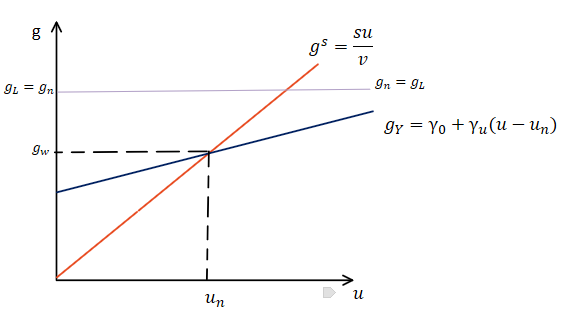
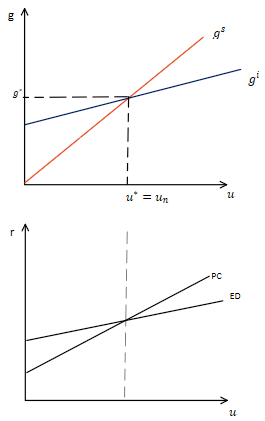
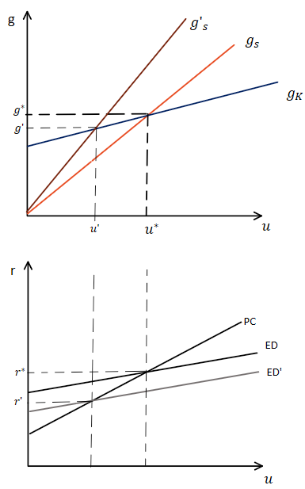
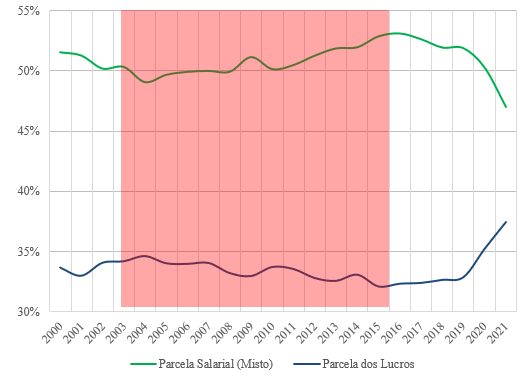

## Exercícios {#sec-exercicios}

Esta seção reúne questões sobre os modelos de Harrod e Kalecki. As
respostas foram mantidas ocultas para permitir que o estudante tente
resolver cada questão antes de consultar a discussão correspondente.
Para visualizar uma resposta, basta abrir o campo **Consultar resposta**
ao final de cada exercício.

## Questão 1 — Variáveis do modelo de Harrod

Preencha a tabela abaixo com uma breve explicação do que cada variável
representa no modelo de Harrod. Além de nomeá-las, procure explicitar a
intuição econômica associada ao papel que desempenham na mecânica do
modelo.

| Variável | Significado e intuição econômica |
|:---|:---|
| Grau de utilização da capacidade instalada |  |
| Relação capital-produto |  |
| Taxa de crescimento efetiva |  |
| Taxa de crescimento planejada |  |
| Taxa de crescimento natural |  |

::: {.callout-note collapse="true" title="Consultar resposta — Questão 1"}
| Variável | Significado e intuição econômica |
|:-----------------------------------|:-----------------------------------|
| **Grau de utilização da capacidade instalada** | $u = \frac{Y}{Y_K} \rightarrow$ É a razão entre o produto corrente e o produto máximo. Indica em que proporção do seu potencial a economia está operando. Na mecânica do modelo, pode ser interpretado como uma medida do nível de aquecimento da economia. |
| **Relação capital-produto** | $v = \frac{K}{Y_K} \rightarrow$ Representa os coeficientes técnicos de produção e procura captar quanto as variações do estoque de capital impactam a capacidade produtiva da economia. Por isso, está associada ao mecanismo do acelerador. |
| **Taxa de crescimento efetiva** | $g_y = \frac{su}{v} \rightarrow$ É a taxa de crescimento efetivamente verificada do produto. Depende da taxa de poupança, do grau de utilização efetivo e da relação capital-produto. |
| **Taxa de crescimento planejada** | $g_W = \frac{s u_n}{v} \rightarrow}$ É a taxa que se manifestaria caso os estoques variassem conforme o planejamento dos produtores. Guarda semelhança metodológica com as expectativas de curto prazo de Keynes; por isso, utiliza o grau de utilização desejado em seu numerador. |
| **Taxa de crescimento natural** | $g_n = g_L + g_A \rightarrow$ Representa o limite de crescimento do produto pelo lado da oferta. Na dinâmica do modelo, depende do crescimento da força de trabalho e da tecnologia. |
:::

## Questão 2 — As três taxas de crescimento em Harrod

O modelo de Harrod estabelece três taxas de crescimento. No equilíbrio,
essas taxas devem se igualar para que o resultado exibido pelo modelo
seja considerado estável. Na representação gráfica abaixo, a taxa de
crescimento natural, associada ao crescimento populacional, encontra-se
acima da taxa de equilíbrio estacionário.

{#fig-harrod-tres-taxas
fig-alt="Gráfico do modelo de Harrod com as taxas de crescimento efetiva, planejada e natural em função do grau de utilização."
width="78%"}

**a)** Neste contexto, discuta brevemente quais seriam os efeitos de uma
atuação pública que aqueça a economia, elevando o grau de utilização
acima do nível desejado.

**b)** Feito isso, apresente, de acordo com o que foi discutido no
curso, a visão de Harrod sobre os limites desse efeito.

::: {.callout-note collapse="true" title="Consultar resposta — Questão 2"}
**a)** O contexto apresentado é aquele em que o crescimento populacional
(superior ao crescimento efetivo da economia) convive com uma taxa de
crescimento efetiva inicialmente compatível com a taxa desejada. Isso
sugere uma elevação persistente do desemprego. Em princípio, uma
política pública capaz de aquecer a economia poderia combater esse
resultado, elevando o grau de utilização e deslocando a trajetória do
produto para cima. Entretanto, quando o grau de utilização corrente
supera o desejado, novos ajustes das expectativas e das decisões dos
produtores tendem a ocorrer. Esses ajustes podem afastar sucessivamente
o grau efetivo do desejado e, portanto, do equilíbrio.

**b)** Para Harrod, à medida que o produto corrente se aproxima do
limite determinado pelo crescimento natural, os empresários tenderiam a
rever suas expectativas para baixo, tornando-se mais reticentes quanto à
manutenção da expansão econômica. Desse modo, o ciclo de boom seria
revertido em um ciclo de recessão.
:::

## Questão 3 — O mecanismo de equilíbrio do modelo kaleckiano canônico

O modelo kaleckiano canônico foi representado neste curso pelo seguinte
sistema de três equações:

\begin{aligned}
r   &= \frac{\pi u}{v},\\
g_s &= s_{\pi}r,\\
g_K &= \gamma_0+\gamma_r r+\gamma_u u.
\end{aligned}

Como em todo modelo macroeconômico, no estado estacionário a taxa de
crescimento da renda será compatível com uma situação em que poupança e
investimento crescem à mesma taxa. Explique, em poucas palavras, qual é
o mecanismo de transmissão que conduz ao equilíbrio desse modelo e por
meio de qual variável ele opera.

::: {.callout-note collapse="true" title="Consultar resposta — Questão 3"}
Pelas equações do modelo, a taxa de lucro aparece tanto na equação da
taxa de poupança quanto na função de investimento. Portanto, o ajuste
entre poupança e investimento ocorre por meio da taxa de lucro.
Entretanto, a taxa de lucro é uma função direta do grau de utilização da
capacidade. Assim, quanto maior o nível de demanda efetiva —
representado pelo grau de utilização —, maior será a taxa de lucro, o
que eleva simultaneamente as taxas de poupança e de investimento.

O mecanismo de transmissão pode ser resumido da seguinte forma:

$$u \uparrow \quad\Longrightarrow\quad r \uparrow
\quad\Longrightarrow\quad g_K \uparrow \quad\text{e}\quad g_s \uparrow.
$$

A variável que permite esse ajuste é, portanto, o **grau de utilização
da capacidade instalada**.

A mesma conclusão pode ser apresentada algebricamente. No equilíbrio,
($g_s=g_K$). Substituindo as funções de poupança e investimento:

$$ s\_{\pi}r=\gamma\_0+\gamma\_r r+\gamma\_u u. $$

Como ($r=\frac{\pi u}{v}$), temos:

$$ s\_{\pi}\frac{\pi u}{v} =
\gamma\_0+\gamma\_r\frac{\pi u}{v}+\gamma\_u u. $$

A expressão evidencia que, dados os parâmetros e as variáveis exógenas
do modelo, o grau de utilização é a variável endógena que permite
compatibilizar as taxas de crescimento associadas à poupança e ao
investimento.

A figura abaixo sintetiza o mecanismo de ajuste discutido na resposta.

{#fig-kaleckiano-mecanismo
fig-alt="Diagrama do modelo kaleckiano canônico mostrando o ajuste entre poupança e investimento por meio do grau de utilização."
width="58%"}
:::

## Questão 4 — O paradoxo da parcimônia (*Paradox of Thrift*)

::::: columns
::: {.column width="50%"}

{#fig-paradoxo-thrift
fig-alt="Gráficos do modelo kaleckiano canônico, com as curvas de poupança, investimento e demanda efetiva antes e depois do aumento da propensão a poupar."
width="68%"}
:::

::: {.column width="50%"}
Na figura ao lado, temos a representação gráfica do modelo kaleckiano
canônico estudado em aula. Tome-a como base para o exercício.

Suponha que um governo diagnostique o baixo crescimento dessa economia
como resultado da insuficiência de poupança doméstica e procure
compensar esse problema por meio de políticas públicas. O governo adota,
então, uma medida bem-sucedida em aumentar a propensão média a poupar da
economia. A expectativa é que, com uma taxa de poupança maior, haja mais
recursos disponíveis para financiar novos investimentos.

**a)** Desenhe duas novas curvas sobre a figura (uma no gráfico superior
e outra no inferior), representando o que muda após a política.

**b)** Em seguida, descreva se as expectativas do governo seriam
alcançadas após o sucesso da medida adotada.
::::: 

::: {.callout-note collapse="true" title="Consultar resposta — Questão 4"}
::::: columns
::: {.column width="50%"}
{fig-alt="Gráficos do modelo kaleckiano canônico, com as curvas de poupança, investimento e demanda efetiva antes e depois do aumento da propensão a poupar."
width="68%"}
:::

::: {.column width="50%"}
O aumento da propensão a poupar reduz o grau de utilização e desloca
para baixo a curva de demanda efetiva, refletindo a menor propensão a
consumir da sociedade. Como consequência, a taxa de lucro efetiva também
diminui, como indicado no gráfico inferior.

Simultaneamente, o aumento da propensão a poupar faz a curva de poupança
girar no sentido anti-horário. O novo equilíbrio é compatível com um
grau de utilização menor e uma taxa de crescimento de equilíbrio também
menor.

Intuitivamente, uma maior propensão a poupar desacelera a demanda. Sem
perspectivas de venda suficientes, os empresários contraem seus
investimentos. O resultado efetivo da política, portanto, é diferente
daquele inicialmente esperado pelo governo. Esse é o **paradoxo da
parcimônia** (*paradox of thrift*): uma tentativa de elevar a poupança
pode reduzir a demanda, o investimento e, ao final, a própria taxa de
crescimento da poupança e do investimento.
:::
::::: 
:::

## Questão 5 — Distribuição funcional da renda, demanda e crescimento no Brasil

O gráfico abaixo apresenta a distribuição funcional da renda no Brasil
entre 2000 e 2021. No período, observa-se um contraste entre a taxa
média de crescimento registrada entre 2005 e 2014 e aquela observada nos
sete anos seguintes, quando passaram a ser adotadas medidas de contenção
do crescimento dos ganhos reais dos salários. Ressalta-se que a taxa
média de crescimento do período sombreado no gráfico foi superior à do
período subsequente.

{#fig-distribuicao-renda-brasil
fig-alt="Participação salarial e participação dos lucros na renda no Brasil, de 2000 a 2021, com destaque para o período de 2003 a 2015."
width="82%"}

De acordo com o modelo kaleckiano canônico estudado em sala, contraste o
comportamento do grau de utilização da capacidade instalada, da taxa de
lucro e da taxa de crescimento nesses dois períodos. Articule a
explicação com o paradoxo dos custos e analise os regimes de demanda e
de crescimento da economia brasileira.

::: {.callout-note collapse="true" title="Consultar resposta — Questão 5"}
No modelo kaleckiano canônico, a contenção dos salários reduz o nível de
demanda. Com uma demanda menor, a taxa de investimento também se reduz,
produzindo um impacto adicional sobre o grau de utilização. Assim, mesmo
que a participação dos lucros na renda aumente, o grau de utilização
pode cair mais do que proporcionalmente, provocando uma redução da taxa
de lucro. Com a queda do grau de utilização e da taxa de lucro, a taxa
de investimento também diminui.

À luz dos dados apresentados, espera-se, portanto, que o grau de
utilização, a taxa de lucro e a taxa de crescimento tenham registrado
patamares menores a partir de 2015 do que aqueles observados no período
anterior, qunado a parcela salarial crescia lentamente.

Esse resultado é compatível com um **regime de demanda liderado pelos
salários** (*wage-led*), uma vez que uma maior participação dos salários
na renda estaria positivamente relacionada ao grau de utilização.
Pode-se ir além e caracterizar o período como um **regime de crescimento
liderado pelos salários**, pois a taxa de crescimento foi superior no
intervalo em que os salários apresentaram maior participação na renda.
:::
