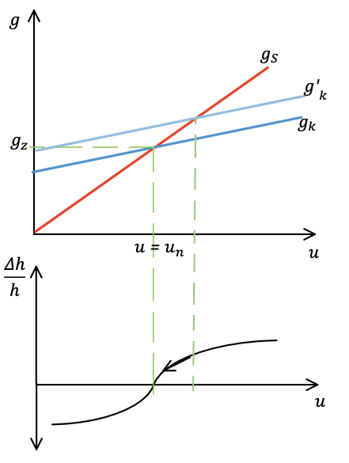
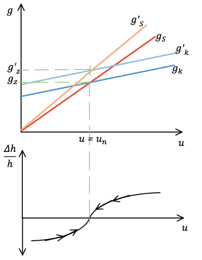
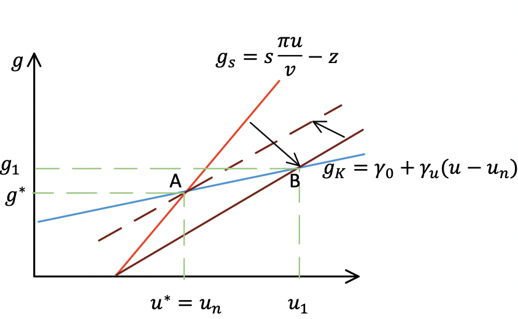
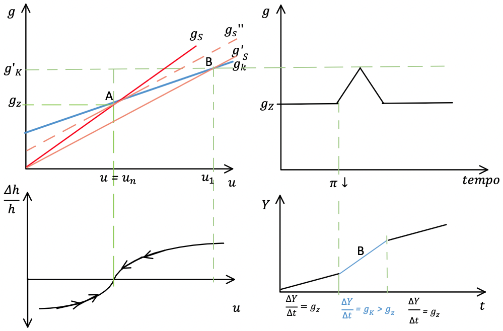

# Modelo Supermultiplicador Sraffiano {#sec-modelo-super}

## Introdução
Nesta seção veremos a estrutura de modelo de crescimento liderado pela demanda que se situa mais na fronteira do debate sobre crescimento enquanto esta apostila está sendo escrita em (2026). Isto não quer dizer que ele seja melhor ou pior do que os demais modelos vistos até aqui, afinal o que seria um modelo melhor?! Diferentes economistas e filósofos poderiam dar diferentes respostas para esta simples questão. O que quero ressaltar é que estudaremos uma estrutura de modelos que, nos últimos anos, passou a ser incorporada por diferentes abordagens heterodoxas. Ainda que o nome deste capítulo faça referência a corrente de pensamento sraffiana, muitos economistas kaleckianos, como Rochon, Lavoie e Allain, passaram a trabalhar com esta estrutura analítica.

Nesta introdução é importante ressaltar dois conceitos fundamentais para a análise que será feita adiante. O primeiro deles passa por responder a seguinte questão: O que tem de sraffiano no modelo?

Esta não é uma questão fácil de responder, até porque há sraffianos críticos a esta estrutura^[Como, por exemplo, Man-Seop Park, Antonella Palumbo and Attilio Trezzini]. Contudo, há um ponto que remete diretamente o modelo desta seção à teoria sraffiana, que é: a taxa de lucro exógena. Na teoria sraffiana, a taxa de lucro normal é exogenamnete determinada pela taxa de juros básica da economia, exógenamente determinada pelo Banco Central e fruto do conflito de classes. A ideia é que, para uma dada estrutura concorrencial, a taxa de lucro normal será a taxa de juros básica da economia acrescida de um *spread* para remunerar o risco do investimento. Taxas de lucro acima desta taxa "normal" seriam consideradas extraordináriamente altas e induziriam novos entrantes, aumentando a concorrência via preços menores e reduzindo a taxa de lucro. Alternativamente, taxas de lucro menores do que a normal não compensariam o risco da atividade empresarial, uma vez que rentabildiade equivalente poderia ser alcançada sem riscos a partir de aplicações financeiras em títulos da ddívida pública.

O segundo conceito importante diz respeito à definição de gastos autônomos. Veja, nos modelos de determinação da renda, os gastos autônomos são definidos como aqueles que independem do nível de renda corrente, portanto, conseguem estimular a demanda e aumentar o nível de emprego (pelo menos nos modelos keynesianos de determinação da renda). Contudo, apenas esta definição não é o suficiente para falar de gastos autônomos em uma teoria dinâmica de longo prazo. Isto porque se o gasto autônomo aumentar a capacidade produtiva ($Y_K\uparrow$) juntamente com a demanda ($Y \uparrow$), a demanda efetiva não será impactada no longo prazo $\left( u=\frac{Y \uparrow}{Y_K \uparrow} \right)$. Portanto a definição de gastos autônomos adotada neste capítulo denota os gastos que obedecem duas características:

  -  ser independente do nível de renda corrente e;
  -  não gerar capacidade produtiva

Intuitivamente, podemos pensar no gasto público construindo uma empresa estatal. Este é um exemplo de gasto independente da renda, mas que gera demanda ao mesmo tempo que cria capacidade produtiva para atender esta demanda. No longo prazo, o feito líquido deste gasto sobre o crescimento produtivo será nulo, pois ele não mudará o grau efetivo de utilização do estoque de capital.

Agora, podemos pensar em outras formas de gastos:

  -  Consumo imobiliário ou de bens duráveis financiados por crédito;
  - Exportações
  - Gastos públicos não geradores de capacidade

Veja que as pessoas não compram casas ou geladeiras só porque tiveram um acréscimo marginal em sua renda. Normalmente, estes gastos estão muito mais associados com variações do acesso ao crédito e em suas condições. No caso das exportações, por exemplo, elas respondem ao nível de renda do país que compra as mercadorias e não com a do que vende. Outrossim, estes gastos representam consumo final e não geram capacidade produtiva por si só.

No entanto, os formuladores de política econômica tem pouco ou nenhum controle sobre estas formas de gastos, mas tem controle quase completo sobre os gastos públicos, o que faz deste componente um fator muito importante. Um governo monetáriamente soberano não enfrenta qualquer restrição para ampliar seus gastos e, portanto, ele pode controlar a taxa de crescimento de tais gastos de forma completamente autônomoa e, como veremos ao longo deste capítulo, estes gastos têm um papel importantíssimo no crescimento econômico de longo prazo. Segundo o modelo do supermultiplicador sraffiano é a taxa de crescimento dos gastos autônomos que explicam o diferencia de renda entre os países.

Por fim, a inclusão dos gastos autônomos, apesar de importante, não é fácil de ser feita nos modelos harrodiano e kaleckiano. Quando consideramos um gasto autônomo neste modelo, eles reagem de forma explosiva ou implausível como veremos nas duas primeiras seções deste capítulo ao expor as críticas sraffianas a estes modelos. Nas seções seguintes construíremos o modelo do supermultiplicador sraffiano com um *framework* substancialmente diferente do que vimos até aqui na apostila.

## Crítica à instabildiade de Harrod {#sec-harrod-super}

Para entender a anatomia do modelo do supermultiplicador precisamos
reinterpretar o modelo de Harrod a partir da leitura do "acelerador
rígido" do investimento.Podemos constatar este aspecto pela
@eq-acelerador-harrod, em que o investimento responde de maneira
uniforme para qualquer diferença entre o grau de utilização corrente e o
planejado.

Primeiro podemos definir a relação capital produto como:
$$v= \frac{K}{Y_K}$$ para em seguida reajustar os termos:
$$\begin{aligned}K &= v Y_K  \\
\Delta K &= v \Delta Y_K \end{aligned}$$

podemos notar que o investimento $(I=\Delta K)$ será o produto do
acelerador e do crescimento da renda. Por conveniência, reescreveremos a
equação como: $$ I= v(Y_{t-1} - Y_{t-2})$$ Mais importante do que notar
os elementos trazidos por esta equação é notar a ausência de elementos,
especificamente: a sensibilidade do ajuste. Isto é, quero chamar a
atenção para o fato de que esta equação está assumindo que os
empresários reagem imediatamente e integralmente a variações de demanda.
É como se todo e qualquer desvio de demanda impactasse imediatamente na
decisão de investimento. O motivo para isso: *temos um acelerador
rígido*.

::: {#nte-acel-super .callout-note}
### Acelerador rígido vs. acelerador flexível

Para explicitar a hipótese assumida, imagine que a função acima
estivesse especificada como $I= \alpha v (Y_{t-1} - Y_{t-2})$ em que
$\alpha$ representasse a velocidade de ajuste do estoque de capital.
Isto é, $\alpha$ mede em que medida o empresário considera as variações
na demanda para sua decisão de investimento. Se $\alpha < 1$ teremos a
hipótese de um ajuste parcial, o que intuitivamente representaria uma
reação do investimento de forma gradual e menor do que a variação na
demanda. Nesta cisrcunstância choques não persistentes de demanda não
levariam o empresário ampliar sua capacidade produtiva.

Contudo, da forma como foi especificada por Harrod, está implícito que
$\alpha =1$. Nesta circunstância, temos que o investimento se mostra
muito sensível à demanda.
:::

Agora vamos ver as implicações disso na determinação da renda. Lembremos
da renda pela ótica da despesa. Asuma que $C = cY$ é o consumo
macroeconômico, computado pela propensão a consumir $c$ da renda. O
Investimento agregado é representado por $I$, enquanto $Z$ denota o
gasto autônomo. Substituindo a função de investimento acima na equação
da renda chegamos em: $$\begin{aligned}
Y &= C + I + Z \\
Y &= cY + v (Y_{t-1}-Y_{t-2}) + Z \\
Y &= \frac{v (Y_{t-1}-Y_{t-2}) + Z}{1-c}
\end{aligned}$$

Se no estado estacionário tivermos $Y_{t-1}=Y_{t-2}$, podemos
simplificar a equação acima como: $$\boxed{Y^*= \frac{Z}{1-c}}$$

Em que o nível de renda do estado estacionário será um múltiplo do gasto
autônomo.

Como a @eq-k-har define o estoque de capital como produto do acelerador
e da renda, podemos usar a equação acima para deduzir que:
$$K = \frac{vZ}{1-c}$$ Agora vamos imaginar que o governo cresça o gasto
público (autônomo) persistentemente a uma taxa constante. A estabilidade
do modelo de Harrod requer que o aumento da demanda hoje $(Z\uparrow)$
não cresça a capacidade produtiva $(K\uparrow)$ mais que
porporcionalmente. Intuitivamente, quando os gastos sobem e aquecem a
demanda efetiva, o investimento não pode subir mais do que o aumento da
demanda. Caso isso aconteça, o aumento do investimento iniciará um novo
ciclo expansionista, que se repetirá sucessivamente, gerarando um efeito
"bola de neve". Isto colocaria a economia em uma instabilidade
infindável. Algebricamente, esta condição pode ser representada por:
$$\frac{v}{1-c} < 1$$

já que qualquer variação em $Z$ provocará alterações menores em $K$,
desde que multiplicado por valores menores que 1. Rearranjando os termos
da desigualdade acima, podemos reescrever a condição de estabilidade
como: $$v+c <1 $$

O que siginifica que a propensão total a gastar da economia, somadas a
propensão a investir e a consumir, deve ser menor do que a unidade. No
entanto, a fragilidade deste modelo é que empiricamente o $v$ costuma
ser bem superior à unidade (em torno de 2 à 4), o que inviabiliza a
estabilidade do modelo.

Normalmente, os autores que usam o mecanismo do acelerador rígido acabam
por pressupor a existência de um teto exógenamente determinado para o
crescimento (como Harrod fez com a taxa de crescimento natural). Assim,
com o artíficio de considerar uma variável exógena como limitante,
conseguem garantir que o ciclo de demanda crescente encontre o limite e
reverta sua tendência. Contudo, ao fazerem isso acabam abrindo mão de
oferecer uma explicação plausível para os determinantes do crescimento.

::::: columns
::: {.column width="50%"}
{#fig-harrod-super
width="100%"}
:::

::: {.column width="50%"}
Se lembrarmos da condição de estabilidade do @sec-modelo-harrod, veremos
que para $g_y = g_w$ temos que ter:

$$\frac{su}{v} = \frac{s u_n}{v} $$ {#eq-suv-super}
:::
:::::

Suponha que a economia esteja no equilíbrio estável representado no
ponto A da @fig-harrod-super e o Governo faça política fiscal
expansionista, aumentando a taxa de crescimento dos gastos autônomos.
Isso aumentaria o grau de utilização de $u_n$ para $u_1$, aquecendo a
demanda e fazendo os empresários incorporarem completamente esta mudança
em suas decisões de investimento. Assim, em vez de estabilizar no ponto
B, com o investimento reagindo ao choque inicial, seríamos levados para
o ponto C, onde o grau de utilização é ainda maior do que o desejado
pelos empresários $(u_2 > u_1 > u_n)$.

Por não háver nenhum mecanismo endógeno de ajuste das variáveis
$s, u, u_n$ e $v$, o modelo tenderia a apresentar uma tendência de
aceleração infinita da renda. Para Harrod isso não seria um problema,
pois o autor acreditava que conforme a taxa efetiva $(g_y)$ se
aproximasse da taxa natural de crescimento máximo $(g_n)$, os
empresários reconheceriam o fato de que a economia se aproxima da sua
plena capacidade, reavaliariam suas expectativas e diminuiriam seu
ímpeto a investir. Com esta redução, a economia entraria em ciclos que
se alternariam entre expansão e recessão.

Ainda que este artíficio analítico permita Harrod explicar ciclos
econômicos e se livrar de um comportamento "explosivo" em seu modelo,
sua adoção implica a não determinação do crescimento. Ou seja, se você
perguntar ao modelo de Harrod a razão para existir ciclos de longo prazo
na economia capitalista, talvez obtenha uma resposta satisfatória (ou
não), mas você não obterá qualquer explicação se seu interesse for sobre
qual fator causa o crescimento econômico no longo prazo.

## Crítica ao mecanismo de ajuste Kaleckiano

Os modelos Kaleckianos tratados nos capítulos passados conseguem prover
uma explicação plausível para o crescimento a partir de mecanismos
estabilizadores próprios, como o grau de utilização. Contudo, um ponto
fortemente criticado pelos sraffianos em relação aos modelos de
crescimento liderados pela demanda expostos até aqui reside na falta de
tratamento adequado para o crescimento dos gastos autônomos. A forma
como estes modelos lidam com um crescimento constante dos gastos
fiscais, por exemplo, não é considerada satisfatória para alguns autores
sraffianos e mesmo alguns kaleckianos. Para os modelos Kaleckianos toda
a dinâmica dos gastos é induzida pela renda, o grau de utilização, por
meio de ajustes na taxa de lucro, passa a se tornar responsável por
estabilizar a economia (conforme @eq-equilibrio-passo1).

Revisitando a @eq-u-estrela, vemos que o aumento do gasto autônomo
($\gamma_0 \uparrow$) eleva o grau de utilização do estado estacionário.
Isto acontece pois o modelo considera a distribuição de renda dada,
portanto, o aumento do gasto autônomo, por meio de uma política fiscal
expansionista, por exemplo, deslocaria apenas a reta do investimento
($g_K$), aumentando o grau de utilização corrente e o desejado. Na
prática, é como se o capitalista fosse obrigado a rever o seu grau
desejado conforme erra suas expectativas.

Considerando uma função de investimento genérica como:
$$ g_k = \gamma_0 + \gamma_u (u - u_n)$$

::::: columns
::: {.column width="50%"}
{#fig-kalecki-super
width="100%"}
:::

::: {.column width="50%"}
Não é difícil notar que, diante um aumento dos gastos autônomos que
amplie o grau de utilização efeitvo $(u^* \rightarrow u^*_1)$, não
ajustar seu grau desejado seria análogo a se deparar, persistentemente,
com uma demanda maior que a esperada. Assim, a solução à instabilidade
do modelo de Harrod, após a introdução de um chqoue de demanda, seria
fazer o ajuste via o grau desejado pelos empresários. Nesta tradição se
os gastos autônomos aumentarem persistentemente o $u$, a igualdade da
@eq-suv-super é mantida via ajustes no $u_n$.
:::
:::::

A crítica de Serrano (1995) e Allain (2015), portanto, vai no sentido de
incorporar uma taxa de crescimento dos gastos autônomos e se perguntar
até que ponto seria o grau de utilização normal que deveria se ajustar
ao efetivo ou o contrário. Na leitura destes autores críticos, na
hipótese de um gasto autônomo crescendo mais, o grau de utilização
efetivo cresceria e induziria novas decisões de investimentos no
curto/médio prazo. Mas, diferente da história contada até aqui pelos
modelos kaleckianos, Franklin Serrano entende que uma vez maturado, o
investimento realizado se torna capacidade produtiva, reduzindo o grau
de utilização no longo prazo de volta para o seu grau desejado. Ao final
desta história, os empresários conseguiriam convergir o seu grau efetivo
exatamente para o desejado no longo prazo, sem espaço para erros
sistemáticos.

Para garantir tal ajuste é preciso considerar que o princípio da demanda
efetiva seja válido no curto e no longo prazo. Segundo este princípio,
todo e qualquer gasto efetivado sempre gerará uma poupança bruta de
igual valor, independentemente do nível de preços e de juros. Portanto,
se existe uma taxa de crescimento do gasto induzido pela propensão a
consumir e uma taxa de crescimento do gasto autônomo, há de ter,
equivalentemente, uma taxa de poupança induzida conforme a propensão a
poupar e uma taxa de poupança autônoma.

Partindo da definição de poupança como uma parcela da renda, como os
gastos autônomos $(Z)$, por não dependerem da renda prévia, irão drenar
o montante poupado:

$$ S = s_r Y - Z$$

Dividindo os dois lados por $K$, chegamos em:

$$ \frac{S}{K}=s_r \frac{Y}{K} - \frac{Z}{K} $$

Agora, multiplicando o primeiro termo do lado direito por
$\frac{Y_K}{Y_K}$, chegamos em:

$$g_s = s_r \frac{Y}{K} \frac{Y_K}{Y_K}- \frac{Z}{K} $$

Finalmente, temos a taxa de crescimento da poupança após feito o ajuste
sraffiano: $$ g_s = s_r \frac{u}{v} - \frac{Z}{K} $$ {#eq-gs-super}

Alternativamente, se quisermos manter a representação Kaleckiana para
fins comparativos, podemos assumir toda a poupança induzida como oriunda
dos lucros para reescrever a equação acima como:

$$g_s = s_r \frac{ \pi u}{v} - \frac{Z}{K} $$.

::: callout-important
### A nova taxa de poupança

Uma observação importante neste momento é distinguir a propensão
marginal a poupar $(s_r)$ da taxa média de poupança $(s)$. Podemos obter
a média da poupança dividindo seu estoque pela renda:

$$\begin{aligned}
\frac{S}{Y} &= \frac{s_r Y}{Y} - \frac{Z}{Y} \\
s &= s_r - z
\end{aligned}$$

Em que $z = \frac{Z}{Y}$.

Consequentemente, temos que para qualquer nível positivo de gastos
autônomos, a taxa média de poupança da economia será inferior à
propensão marginal a poupar. Neste modelo, a propensão marginal a poupar
determina apenas um limite para a taxa de poupança e não,
necessariamente, seu patamar. O que parece uma conclusão trivial se
considerarmos que todo gasto gera sua própria poupança, mesmo que no
longo prazo.
:::

A equação acima me diz que quanto maior for a razão de gastos autônomos
sobre a renda, menor será a taxa de poupança da economia.
Intuitivamente, talvez fique mais fácil entender esta diferença se
definirmos a taxa de crescimento da poupança como: $$ g_s= s r u$$

e resolvermos para $s$, tal como: $$s = \frac{g}{ru}$$ Repare que se o
crescimento dos gastos autônomos conseguir afetar o $g$ no longo prazo,
ele aumentará a taxa média de poupança da economia, ainda que a
propensão a poupar dos lucros permaneça constante. Assim, apesar de o
$s$ se ajustar à taxa de crescimento, aqui estamos nos referindo à taxa
média de poupança da economia e não à propensão marginal a poupar, como
nos modelos de Robinson e Kaldor.

Estas críticas (feitas principalmente por Franklin Serrano) serviram de
insumo para a construção de um novo modelo de crescimento. Neste novo
modelo, além de considerar o crescimento dos gastos autônomos em um
mundo em que a demanda efetiva vale no curto e no longo prazo, a
estabilidade do modelo vem da flexibilidade do acelerador e não do
ajuste no grau de utilização desejado. Assim, o modelo não requer que
capitalistas sejam convencidos a mudar de opinião (grau de utilização
desejado) sempre que se depararem com choques de demanda. Nesta versão
construída por sraffianos (Serrano, 1995) e kaleckianos (Alain, 2015),
dado o crescimento dos gastos autônomos, a taxa média de poupança
garante que o grau de utilização efetivo convirja para o grau desejado
pelos empresários, evitando que estes incorram em erros persistentes e
nem alterem suas expectativas a cada período de investimento.

Nas próximas seções veremos como o princípio do ajsute do estoque de
capital \[representado por $(u-u_n)$\] reflete na propensão a investir
dos empresários (representada por $h$) e, consequentemente, na taxa
média de poupança ($s$). Dentro dos termos discutidos nesta seção, o
modelo do supermultiplicador garante o ajuste da @eq-suv-super por meio
de variações em $s$, ainda que a propensão marginal a poupar da
sociedade não se altere. Lembremos, que o $s$ aqui representa a taxa
média de poupança ($S/Y$), que é apenas uma fração da propensão a poupar
da sociedade. Intuitivamente, estamos lidando com um modelo de
acelerador flexível, em que o aquecimento da demanda ($Y\uparrow$)
aumenta o efeito acelerador e garante o ajustamento da capacidade
produtiva ($Y_K \uparrow$) de forma proporcional à demanda
$\left(u_n=u=\frac{Y\uparrow}{Y_K \uparrow}\right)$. Veremos como isto
ocorre nas próximas seções.

## A definição da renda a partir do investimento induzido {#sec-inv-super}

Dada a crítica aos modelos de "Oxbridge"[^modelo_super-1], precisamos
retornar ao modelo de Harrod estudar a taxa de crescimento efetivo
considerando os gastos autônomos e o príncipio da demanda efetiva
valendo no curto e no longo prazo.

[^modelo_super-1]: Serrano se refere aos modelos de Harrod e Kaleckianos
    como de Oxbridge, pelo fato de reunirem contribuições de
    pesquisadores oriundos de Oxford e Cambrisge.

Primeiro vamos começar com duas equações comportamentais. A primeira
define a função consumo como uma propensão a consumir $(c)$ da renda, em
que $0<c<1$. A segunda equação determina a função de investimento da
forma mais simples possível, em que o investimento agregado será uma
parcela da renda, que pode ser lida como a propensão $(h)$ a investir da
renda: $$ \begin{aligned}C&= cY \\ I&=hY \end{aligned}$$

Colocando estas equações comportamentais em uma equação contábil:
$$\begin{aligned}
&Y = C+I+Z \\
&Y = cY + hY + Z \\
&Y - cY - hY = Z \\
&Y (1-c-h) = Z \\
\end{aligned}$$

$$ Y= \frac{Z}{1-c-h}$$ {#eq-y-super}

Tirando o diferencial dos dois lados da equação, temos que:

$$\Delta Y = \frac{1}{1-c-h} \Delta Z$$

Dividindo os dois lados da equação por $Y$, e fazendo uma manipulação
algébrica, chegamos em: $$\begin{aligned}
\frac{\Delta Y}{Y} &= \frac{1}{1-c-h} \frac{\Delta Z}{Y} \\
\frac{\Delta Y}{Y} &= \frac{1}{1-c-h} \frac{\Delta Z}{Y} \frac{Z}{Z} \\
\frac{\Delta Y}{Y} &= \frac{1}{1-c-h} \frac{\Delta Z}{Z} \frac{Z}{Y} \end{aligned}$$

Vamos definir $g_y = \frac{\Delta Y}{Y}$ como o crescimento efetivo da
renda e $g_Z = \frac{\Delta Z}{Z}$ como a taxa de crescimento dos gastos
autônomos e, por fim, $z=\frac{Z}{Y}$ como proporção dos gastos
autônomos na renda. Então podemos escrever a equação acima como:

$$ \boxed{g_y = \frac{1}{1-c-h} g_Z z } $$ {#eq-gy-super}

O último termo desta equação é muito iportante, pois nos permite
concluir um dos resultados mais originais desta apostila. Repare que
esta equação traz duas variáveis de interesse: a taxa de crescimento
efetiva da renda e taxa de crescimento dos gastos autônomos. Resta saber
qual delas determinará a outra.

Sempre que a taxa de crescimento da renda superar a taxa de crescimento
dos gastos autônos $(g_y > g_Z),$ a parcela deste último na renda estará
se reduzindo $(z\downarrow)$. Pela @eq-gy-super temos que a queda de $z$
reduzirá a taxa de crescimento efetiva da renda. Intuitivamente,
enquanto a renda crescer mais rápido que os gastos autônomos, a
capacidade produtiva da economia crescerá relativamente mais do que a
demanda agregada, já que um componente importante dela (o gasto
autônomo) não estará crescendo no mesmo ritmo. Com isso, o grau
ociosidade amentará com o tempo e desaquecerá a economia.

Caso contário, sempre que a taxa de crescimento dos gastos autônomos for
maior do que a taxa de crescimento da renda efetiva $(g_Z>g_y)$ teremos
que a parcela numerador de $z$ crescerá mais do que o denominador,
aumentando a razão. Como demonstrando pela @eq-gy-super, o aumento de
$z$ levará, tudo o mais constante, ao aumento da taxa de crescimento
efetiva da renda. Intuitivamente, enquanto $g_Z$ superar $g_y$, a
demanda agregada estará crescendo mais do que a capacidade produtiva,
aumentando o grau de utilização e induzindo uma maior parcela de
investimentos na renda. Com o grau de utilização subindo, o ajuste
ocorre no sentido correto, isto é, aumentando $g_y$ até igualar ao
$g_z$.

Portanto, a igualdade entre $g_Z$ e $g_y$ estará garantida por meio do
princípio de ajuste do estoque de capital garantindo que a taxa de
crescimento da renda convirja para a taxa de crescimento dos gastos
autônomos. Finalmente podemos concluir que é a taxa de crescimento dos
gastos autônomos que causa a taxa de crescimento da renda.

::: callout-important
A taxa de **crescimento da renda** converge, por meio de ajustes no grau
de utilização, para a t**axa de crescimento dos gastos autônomos**.
:::

Algebricamente, podemos notar que o a taxa de crescimento da renda
converge para taxa de crescimento dos gastos autônomos, se lembrarmos da
@eq-y-super. Ao manipulá-la, podemos escrever
$\frac{Z}{Y}=s-h$[^modelo_super-2]. Agora, retornando na @eq-gy-super e
substituindo $z$ por $s-h$, temos que:

[^modelo_super-2]: Para facilitar a notação podemos definir $1-c=s$

$$ \begin{aligned}
g_y &= \frac{g_Z (s-h)}{s-h} \\
g_y &=g_Z \end{aligned}$$

## A taxa de investimento

Serrano afirma que o modelo do supermultiplicador sraffiano, na verdade,
seria compatível com diferentes funções de investimentos kaleckianas. No
entanto, para manter a formulação o mais simples possível, podemos
representar o investimento simpleste como induzido pela renda. Sendo
assim, o investimento será uma propensão $h$ a investir da renda.

$$I=hY$$ Onde podemos ober a taxa de crescimento do estoque de capital
por:

$$\begin{aligned}
\frac{I}{K} &=\frac{hY}{K} \\
g_K &= h \frac{Y}{K} \end{aligned}$$

Multiplicando o lado direito da equação por $\frac{Y_K}{Y_K}$ podemos
obter:

$$\begin{aligned} g_K = h \frac{Y}{K} \frac{Y_K}{Y_K} \\
g_K = h \frac{Y}{Y_K} \frac{Y_K}{K} \end{aligned} $$

$$g_K = h \frac{u}{v}$$ {#eq-gk-super}

O diferencial do modelo do supermultiplicador não está exatamente na sua
função de investimento, mas no princípio do acelerador flexível, em que
a propensão marginal a investir é que passa a ser a variável ajustada
pelo grau de utilização. Assim, podemos estabelecer a equação dinâmica
do modelo como:

$$\frac{\Delta h}{h} = \gamma_u (u-u_n)$$ {#eq-h-super}

Ou, alternativamente: $$ \Delta h = h \gamma_u (u - u_n)$$ Repare que o
acelerador agora se torna flexível, pois há um termo de ponderação que
se altera com mudanças na demanda efetiva.

Com isso, sempre que o grau de utilização ficar acima do desejado, os
empresários ampliarão sua propensão a investir para recompor seu grau
desejado de ociosidade. A medida em que os investimentos maturam e viram
capacidade produtiva, o grau de utilização efetivo cai e coverge para o
planejado, de forma a estabilizar a propensão a investir dos
empresários.

Aqui reside a importância na definição do gasto autônomo como não
criador de capacidade produtiva. Pois se o gasto, além de ser autônomo
da renda, acabasse por ampliar a capacidade da produtiva $(Y_K)$ junto
com a demanda efetiva $(Y)$, o grau de utilização efetico poderia não se
alterar o mecanismo de ajuste ficaria inoperante.

A princípio, para qualquer valor de $h$ menor do que a unidade teríamos
a impossibilidade de a variação do investimento superar ou igualar a
variação na demanda (como ocorre no modelo de Harrod). No entanto, ainda
que o $h$ seja maior do que um, isso faria com que a capacidade
produtiva subisse mais rápido do que a demanda efetiva
$\downarrow u = \frac{Y\uparrow}{Y_K \uparrow \uparrow}$. Assim, suponha
uma situação inicial em que $h>1$ e, portanto, $g_K > g_y$. Isso
automaticamente levaria a uma situação em que $u<u_n$, pelo fato de a
capacidade produtiva estar subindo mais rápido do que a demanda,
reduzindo a propensão empresarial a investir $(\frac{\Delta h}{h} < 0)$.

Contudo, o caso de maior interesse para nossa análise reside na hipótese
de $h<1$. Neste caso, podemos partir de um ponto em que $g_K < g_y$,
onde a demanda efetiva estará crescendo acima da taxa de acumulação de
capital, gerando um grau de utilização efetivo superior ao desejado
$(u > u_n)$ e, consequentemente, um crescimento da propensão a investir
dos empresários. Pela @eq-gk-super podemos ver que $\Delta h >0$ conduz
ao aumento da taxa de acumulação do estoque de capital até fazer com que
esta se iguale à taxa de crescimento da demanda efetiva.

A estabilidade da taxa de investimento só ocorre quando $g_K=g_y$ e,
portanto, $u=u_n$. Neste caso, a propensão a investir dos capitalistas
estará constante e estabilizará $g_K$ no mesmo nível da $g_y$.

Contudo, conforme discutido na @sec-inv-super, a taxa de crescimento da
renda converge para a taxa de crescimento dos gastos autônomos, o que
nos permite dizer que se $g_Z=g_y$, então: $g_Z = g_K$. Resumidamente,
vimos até agora que a taxa de crescimento do estoque de capital tende
para a taxa de crescimento da renda, que por sua vez converge para a
taxa de crescimento dos gastos autônomos. Em outras palavras, quando os
gastos autônomos crescem, estimulam a demanda efetiva e a taxa de
crescimento da renda, levando o grau de utilização para patamares acima
do desejado pelos empresários. Caso esta taxa superior de $g_Z$ seja
mantida, a propensão a investir sobe e aumenta também a taxa de
investimento até que a maior capacidade produtiva se reflita em queda do
grau de utilização efetivo, que retorna ao patamar desejado.

## Posição de ajuste total {#sec-ajuste-super}

Até aqui construímos uma sequência argumentativa de nexos causais que
nos levam a:
$g_Z \uparrow \rightarrow g_y \uparrow \rightarrow g_K \uparrow$.
Resta-nos perguntar se esta é uma posição de equilíbrio macroeconômico
ou trata-se apenas de uma posição transitória para um novo equilíbrio.
Como sabemos, a posição de equilíbrio macroeconômico ocorre quando temos
$I=S$, ou, em termos dinâmicos $g_K=g_s$.

Pelo que foi discutido até aqui, é fácil ver que: $$ I = hY = S$$
portanto, a renda que está multiplicando passa para o outro lado
dividindo e chegamos em: $$\frac{S}{Y} = h$$ {#eq-sy-super} A propensão
média a poupar da renda será móvel e apresentará variações proporcionais
à @eq-h-super. Assim, quando o grau de utilização efetivo convergir ao
grau normal, a variação de $h$ cessa, assim como a propensão média a
poupar. Repare que isso acontece mesmo que a propensão marginal a poupar
não se altere. No fundo, o mecanismo se assemelha muito ao modelo de
Robinson e Kaldor, mas com duas diferenças fundamentais: - Aqui estamos
nos referindo ao ajuste pela propensão média a poupar, para dadas
distribuição da renda e propensão marginal a consumir. - Em última
análise, o ajuste ocorre pela propensão a investir que, pelo princípio
da demanda efetiva, acaba alterando a poupança.

Lavoie (2022) simplificadamente representa este ajuste pela
@eq-gs-super. Repare que $g_s$ será estável uma vez que $g_Z = g_K$,
como demonstrando na @sec-inv-super. No entanto, o patamar de $g_s$ será
tão menor quanto maior for a proporção dos gastos autônomos em relação
ao estoque de capital. Veja que um aumento dos gastos autônomos elevará
a demanda agregada, levando o grau de utilização, temporariamente, acima
do grau desejado e provocando o aumento de $h$ e, consequentemente, da
propensão média a poupar da economia. Com o aumento da propensão média a
poupar e a maturação dos investimentos, o grau de utilização retorna ao
patamar desejado, sem que os empresários precisem mudar sistematicamente
de opinião.

Assim completamos o ciclo causal em que a taxa de crescimento dos gastos
autônomos determina a taxa de crescimento da renda efetiva que, por sua
vez, via propensão a investir, determina a taxa de crescimento do
estoque de capital. Por fim, a taxa de crescimento do investimento
produz uma taxa de crescimento da poupança equivalente:

$$ g_Z \uparrow \rightarrow g_y \uparrow \rightarrow g_K \uparrow \rightarrow g_s \uparrow $$

No final, temos que a taxa de crescimento dos gastos autônomos é a
determinante da taxa de crescimento da economia no Longo Prazo.

## Analisando o equilíbrio com gráficos

::::: columns
::: {.column width="35%"}
{#fig-eqsuper
width="100%"}
:::

::: {.column width="65%"}
A representação gráfica deste modelo pode ser vista na figura ao lado.
Nela, temos o quadrante superior mostrando que a taxa de crescimento dos
gastos autônomos determinará o ponto de equilíbrio do modelo justamente
no intercepto entre as curvas de poupança e investimento, garantindo que
$g_z = g_K = g_s$.

No quadrante inferior, temos a dinâmica do ajuste. Repare que taxa da
propensão a investir será positiva sempre que $u>u_n$. Este mecanismo
garante que, em um contexto de demanda efetiva aquecida, a propensão a
investir cresça e cause um impacto positivo proporcional na taxa de
poupança (ver @eq-sy-super), mesmo que a distribuição de renda e a
propensão marginal a poupar permaneçam inalteradas.
:::
:::::

Intuitivamente, o que temos aqui é que o empresário, ao se deparar com a
demanda aquecida $(u>u_n)$ aumentará sua propensão a investir visando
retornar ao grau de utilização planejado. Esta decisão comportamental
implicará maior capacidade produtiva no futuro, fruto da maturação deste
investimento. Quando isso acontecer, o grau de utilização retorna ao
nível que dono da fábrica deseja. Este mecanismo refelete diretamente a
crítica sraffiana a respeito dos erros sistêmicos de expectativas. Neste
caso, os donos das fábricas conseguem manter o nível de utilização de
seus maquinários, tendendo para o patamar que planejam.

Caso o empresário note que está com muita capacidade ociosa ($u<u_n$,
por conta de $Y\downarrow$), ele reduzirá seu impeto a investir
$(\frac{\Delta h}{h})$. Consequentemente, a capacidade produtiva do
futuro cairá $(Y_K \downarrow)$ até que o grau de utilização
$(u=\frac{Y \downarrow}{Y_K \downarrow})$ retorne ao nível de ociosidade
planejado incialmente, sem que o empresário tenha de alterar seus
planejamentos.

::: callout-note
### Exemplo numérico

Imagine um empresário que deseja manter o grau de utilização de seu
maquinário em 80%, deixando os outros 20% de capacidade instalada como
margem de segurança para absorver eventuais choques de demanda ou
permitir a manutenção de equipamentos. Inicialmente, sua fábrica possui
capacidade produtiva para gerar 1.000 unidades, enquanto a demanda
efetiva é de 800 unidades. Portanto:

$$u = \frac{Y}{Y_K} = \frac{800}{1.000} = 0{,}80$$

Suponha agora que a demanda aumente para 900 unidades. Como a capacidade
produtiva permanece inicialmente em 1.000 unidades, o grau de utilização
sobe para 90%, ultrapassando o nível planejado pelo empresário:

$$u = \frac{900}{1.000} = 0{,}90 > u_n$$

Diante dessa situação, o empresário interpreta que precisa ampliar sua
capacidade produtiva e aumenta sua propensão a investir. Após a
maturação dos novos investimentos, a capacidade produtiva aumenta para
1.125 unidades. Assim, mesmo mantendo a demanda em 900 unidades, o grau
de utilização retorna aos 80% inicialmente planejados:

$$u = \frac{900}{1.125} = 0{,}80$$

O movimento inverso também ocorre. Suponha que, partindo da situação
inicial, a demanda caia de 800 para 700 unidades. Nesse caso, o grau de
utilização recua para 70%, ficando abaixo do nível desejado pelo
empresário:

$$u = \frac{700}{1.000} = 0{,}70 < u_n$$

Diante do excesso de capacidade ociosa, o empresário reduz sua propensão
a investir. Com o passar do tempo, a menor realização de investimentos
líquidos, juntamente com a depreciação do capital existente, reduz a
capacidade produtiva para 875 unidades. Desse modo, mesmo com a demanda
permanecendo em 700 unidades, o grau de utilização retorna ao patamar
planejado:

$$u = \frac{700}{875} = 0{,}80$$

O exemplo ilustra que, nesse mecanismo de ajustamento, é a capacidade
produtiva que se adapta às condições de demanda, permitindo que o grau
de utilização efetivo convirja para o nível planejado pelo empresário.
Portanto, não é necessário supor que os empresários alterem
sistematicamente suas expectativas ou revisem o grau de utilização que
consideram desejável: o próprio comportamento do investimento promove o
ajustamento entre demanda e capacidade produtiva.
:::

Para completar a nossa análise, agora imagine que a taxa de crescimento
dos gastos autônomos aumente para $g'_Z$ (tal que $g'_k > g_k$). Tal
como nos modelos Kaleckianos anteriores, temos o deslocamento da curva
de investimento para cima, interceptando a taxa de poupança em um
patamar superior (veja o quadrante esquerdo da @fig-z-super), mas agora
este não é o fim da história. Dizemos que este seja o resultado de
médio/prazo do modelo, ou seja, o resultado antes a posição de ajuste
final.

::::: columns
::: {.column width="50%"}
{#fig-z-super width="100%"}
:::

::: {.column width="50%"}
{width="100%"}
:::
:::::

Enquanto o grau de utilização ficar acima do planejado, a propensão a
investir seguirá crescendo, assim como a propensão média a poupar. Pela
@eq-gs-super podemos notar que o quadrante da esquerda sugere que
$g'_Z > g_K$, portanto o último termo da equação estará subindo, fato
que reduz a taxa de poupança. Como estamos falando de uma maior taxa de
poupança média, podemos representar este movimento por uma rotação da
$g_s$, de modo a deixá-la mais inclinada (como no quadrante da direita
na @fig-z-super).

Agora temos um ajustamento de longo prazo estável e que suporta uma taxa
de crescimento dos gastos autônomos. Conseguimos isso ainda que os
empresários mantenham seus planos de ociosidade para suas indústrias.
Isso não quer dizer os empresários não podem rever seus planos, mas que
tal revisão não é condição necessária para estabilizar um modelo
analítico. Lembrando da @eq-suv-super e da @eq-sy-super, podemos ver que
a estabilidade da primeira é garantida por ajustes na segunda, para
qualquer grau de utilização desejado.

Como resultado desta abordagem, temos que o único determinante da
tendênica de crescimento no longo prazo é a taxa de crescimento dos
gastos autônomos. O próximo passo, então, é se perguntar os efeitos da
distribuição de renda e da propensão marginal a poupar. Isto é, vamos
estudar os paradoxos do custo e da poupança.

## O paradoxo de Thrifit {#sec-thrifit-super}

Para entender a dinâmica do modelo que acabamos de construir, vamos
fazer alguns exercícios analíticos. O primeiro deles será entender como
a economia se comportará após uma udança na propensão a poupar da
sociedade. Isto é, se a média da sociedade decidir poupar uma parcela
maior da renda, o que acontecerá com a poupança macroeconômica?

Para responder esta questão temos que olhar para a @eq-gs-super e se
perguntar o que aconteceria após a queda de $s_r$. Bom, em um primeiro
momento podemos manter a análise feita nos modelos kaleckianos, em que a
queda da propensão a poupar aciona o efeito multiplicador (ver
@eq-multrenda) e aumenta o crescimento da renda. Em termos de
representação gráfica teríamos a rotação da curva $g_s$ devido a mudança
do seu coeficiente angular ($s_r$), rotacionando-a da reta contínua
vermelha para a reta contínua mais escura. O ponto de equilíbrio de
médio prazo saíoria de A para B. Mas agora este nào é mais o final da
história.

::::: columns
::: {.column width="50%"}
{#fig-thrifit-super
width="100%"}
:::

::: {.column width="50%"}
Com a queda da propensão marginal a poupar e seu impacto sobre o
multiplicador, o grau de utilização supera o desejado e o efeito
acelerador é acionado $\left(\frac{\Delta h}{h} >0 \right)$. Agora, os
empresários aumentarão seu ímpeto a investir buscando aumentar o estoque
de capital para retornar ao grau de utilização planejado. Com o aumento
de $h$, a taxa de crescimento do estoque de capital aumenta de $g^*$
para $g_1$ e supera a taxa de crescimento dos gastos autônomos ($g_Z$),
mantido constante por hipótese. Repare que pela @eq-gs-super, o último
termo terá o numerador da razão crescendo menos do que o denominador,
fazendo com que a razão se reduza. Como esta fração está sendo
subtraída, a sua queda implica aumento de $g_s$, representado por
deslocamentos que levam a reta contínua escura para a reta tracejada. Ao
final do ajuste deste mecânismo, teremos que o grau normal de utilização
retorna ao patamar desejado no ponto A do gráfico.
:::
:::::

Como visto na @sec-ajuste-super, na posição de ajuste total temos que
$g_K = g_Z$, fato que garante que o $g_s$ não cairá para sempre e se
estabilizará quando a taxa de crescimento convergir de volta para a taxa
de crescimento dos gastos autônomos.

O resultado da análise, então, indica que a queda da propensão marginal
a poupar leva a um aquecimento temporário da economia, aumentando a taxa
de crescimento por alguns períodos, mas não é capaz de sustentar uma
taxa de crescimento maior para sempre. Com o passar do tempo, o ajuste
da capacidade produtiva ocorre e o patamar do grau de utilização retorna
ao seu nível desejado, compatível com a taxa de crescimento dos gastos
autônomos. Assim, o paradoxo da poupança é válido por certo tempo, mas
não é válido no ponto de estado estacionário no longo prazo.

Por fim, é importante chamar atenção para a diferença entre a taxa de
crescimento do estado estacionário e a taxa de crescimento média do
período. Para isso, vamos supor que estamos falando de três períodos. O
período $t$ representa o estado inicial da economia, sobre o qual o
choque será aplicado, supondo a queda da propensão marginal a poupar. O
período $t+1$ representará o período intermediário, no qual a economia
estará em processo de ajustamento até atingir o estado estacionário no
período $t+2$.

O resultado do modelo do supermultiplicador sraffiano sugere que a taxa
de crescimento em $t+2$, será igual à taxa de crescimento em $t$ e
idêntica a taxa de crescimento em $t+i$ para todo $i>2$. Fato que sugere
que a economia seguirá crescendo à taxa que vinha crescendo antes do
choque sobre a propensão marginal a poupar. No entanto, isto não quer
dizer que o choque não teve efeitos materiais sobre aquela economia.
Durante o período de ajuste $t+1$ a economia cresceu mais e o nível de
renda aumentou permanentemente. Por mais que a *taxa* tenha retornado ao
patamar inicial, a porcentagem será aplicada sobre um nível maior e isso
tem efeitos práticos para a economia real. Dito de outra maneira, ainda
que a taxa de crescimento em $t+2$ seja igual à taxa em $t$, se
calcularmos a média de crescimento em $t, t+1$ e $t+2$, ela será maior
devido a queda da propensão a poupar.

Vamos supor, só por mero exercício da imaginação, que cada período deste
corresponda à 20 anos. Temos que num período histórico de 20 anos, esta
economia registrou uma taxa de crescimento superior ao que vinha
registrando antes e ao que computará adiante. Note que isso não é pouca
coisa, mas para fins analíticos, o modelo conclui que o paradoxo da
poupança não vale no longuíssimo prazo.

## Paradoxo dos custos.
O segundo exercício analítico consiste em uma mudança exógena na distribuição da renda. Para os sraffianos, a taxa de juros básica da economia, exógenamente determinada pelo Banco Central, estabelcerá um piso mínimo para a rentabilidade do capital. Atividades produtivas ou financeiras que rentabilizem menos do que esta taxa básica acrescida de um *spread* recompensador de riscos serão preteridas a aplicações em títulos da dívida pública que pagam esta taxa básica e são livres de risco. Desta forma, para dado nível concorrencial, a taxa de *mark-up* das firmas e, portanto, a distribuição da renda será influenciada, no longo prazo, pela taxa de juros básica da economia. Neste sentido, a taxa de lucro que os sraffianos chamam de "normal" será exógena e compatível com a taxa de juros básica mais um *spread* de risco.

Suponha então que os salários se alterem devido a uma variação do poder de barganha dos trabalhadores. Neste caso, vamos supor o aumento salarial conquistado pelos movimentos trabalhistas e que, venham a se refletir em uma distribuição de renda favorável a esta classe. Como trabalhado nos capítulos anterior: vamos supor um aumento da parcela salarial na renda.

Bom, pelo efeito acelerador da @eq-multrenda é fácil ver que a queda da parcela dos lucros na renda (compatível com o aumento salarial suposto neste exercício) implicará maior nível de demanda efetiva. Com a demanda efetiva aquecida, os empresários aumentarão sua propensão a investir $(\Delta h > 0)$, fazendo com que o estoque de capital cresça mais do que vinha crescendo antes. Esta racionalidade se explica pelo desejo destes empresários em atender à demanda que cresceu por conta dos salários e ainda assim repor o maquinário que está sendo utilizado, mas ele desejaria que ficasse ocioso. Nos termos discutidos nesta seção: o empresário aumenta sua propensão a investir para repor seu estoque de capital mais que proporcinalmente à demanda, visando trazer o grau de utilização de sua indústria para o nível desejado por ele.

Contudo, este ajuste maior da capacidade não perdurará para sempre. Tão logo o empresário note que está próximo do grau de utilização desejado, ele reduzirá gradualmente sua propensão a investir e quando este nível for atingido, ele manterá os investimentos líquidos crescendo a uma taxa constante para não criar excesso e nem escassez (em relação ao desejado) de capacidade ociosa.

Portanto, ao longo do processo de ajuste, a taxa de crescimento da economia será impulsionada pelos investimentos induzidos pelo aumento da demanda efetiva oriundo da distribuição de renda em favor do trabalho. No entanto, conforme os investimentos forem maturando e ampliando a capacidade produtiva da economia, o grau de utilização vai reduzindo até voltar ao grau normal, compátivel com a taxa de crescimento dos gastos autônomos.

{#fig-custos-super width="100%"}

Para entender a dinâmica do paradoxo dos custos vamos partir do equilíbrio no ponto A no quadrante superior esquerdo do gráfico acima, onde $u=u_n$. Suponha, então, que a parcela dos lucros na renda caia ($\pi \downarrow$). Neste momento, a distribuição de renda afetará a curva $g_s$, pelo fato de trabalhadores ter uma propensão marginal a consumir maior do que capitalistas. Logo, reduzir a parcela da renda de quem tem maior propensão a consumir, aumentando a parcela de quem tem a maior propensão, garante um aumento do gasto induzido pelo multiplicador da renda, representado por uma rotação na curva $g_s$ para $g'_s$ (reta vermelha mais clara).

Com a demanda efetiva subindo, o grau de utilização se aquece (quadrante esquerdo inferior) e aciona o ajuste da propensão a investir. Neste momento, estamos no ponto B, em um ponto transitório, com a taxa de crescimento do estoque de capital elevando a taxa de crescimento da renda acima da taxa de crescimento dos gastos autônomos $(g_K = g_y > g_Z)$. No quadrante direito superior, podemos ver este momento transitório a partir da reta pontilhada vertical da cor verde, sinalizada pela queda da parcela dos lucros na renda $(\pi \downarrow)$. No quadrante inferior da direita, vemos o trecho azul mostrando o nível do produto mais inclinado, denotando esta taxa de crescimento maior.

Contudo, este momento transitório vai gradualmente retornando de B para A a medida que aumentos na propensão a investir também elevam a taxa média de poupança, trazendo a curva $g'_s$ de volta para $g''_s$ (reta clara e tracejada). Com o crescimento do estoque de capital superando o crescimento dos gastos autônomos, o último termo da @eq-gs-super aumenta a taxa de poupança da economia e desloca $g'_s$ para cima até $g''_s$, representando a máxima do PDE: a poupança sempre se ajusta aos gastos. Conforme a taxa de crescimento da propensão a investir reduz gradualmente, o grau de utilização retorna ao seu patamar desejado pelos empresários até que variações em $h$ cessem e o equilíbrio seja novamente alcançado em sua posição de ajuste. Nesta posição final, a taxa de crescimento do estoque de capital converge para a taxa de crescimento dos gastos autônomos, mesmo patamar da taxa de crescimento da renda e da poupança.

Podemos ver o resultado sobre a taxa de lucro lembrando da equação: $r = g / s$. Primeiro é importante reparar que o numerador da razão não se altera pelo fato de tender sempre à taxa de crescimento dos gastos autônomos. Além disso, lembre-se que $s = s_r - Z/Y$ para analisar três fatores:

  - $s_r$ cairá por conta da distribuição de renda em favor dos trabalhadores, cuja propensão a poupar é menor do que a dos capitalistsas;
  - $Z$ permanecerá crescendo a uma taxa constante uma vez que a distribuição de renda não altera sua taxa;
 - $Y$ crescerá mais do que $Z$ durante o período de ajuste do modelo (enquanto o $s_r$ estiver caindo), levando o denominador do último termo da equação a cair e compensar a queda de $s_r$.

Portanto, a taxa de lucro não se alterará quando o ajsute de longo prazo estiver completo. Assim, temos que o **paradoxo dos custos não se sustenta no longo prazo**. Isso significa que este modelo não pode ser classificado como do tipo liderado pelos salários (*wage-led*) ou liderado pelos lucros (*profit-led*). Na verdade, a nomenclatura mais adequada para este modelo é um regime de crescimento **liderado pela demanda**.

Isso é compatível com a teoria sraffiana, em que a taxa de lucro normal (de longo prazo) é exogenamente determinada com base em um diferencial da taxa básica de juros. Dessa forma, apesar do recurso didático usado nos parágrafos acima, o mais adequado seria representar a equação do parágrafo anterior como $s= g / r$ em vez de $r= g / s$, como feito anteriomente. Isto porquê a variável de ajuste no modelo é a taxa média de poupança.

::: callout-note
### Curiosidade

Pariboni (2016) acrescentou o componente autônomo a um modelo com a estrutura proposta por Badhuri e Marglin (discutido no @sec-modelo-bm) e observou que o resultado de um regime de demanda *profit-led* já não seria mais possível.
:::

Retornando à análise da @fig-custos-super, podemos notar, pelo quadrante superior da direita, que com o passar do tempo, a taxa de crescimento da economia retorna ao ponto incial, mesmo após o impacto da distribuição de renda. Contudo, o quadrante inferior da direita nos dá uma dimensão melhor do resultado. Repare que durante o período de ajuste (trecho em azul), o produto da economia deu um salto que não teria ocorrido sem a distribuição de renda. Assim, apesar de o resultado do estado estacionário não ser afetado, uma análsie dinâmica até o ponto de equilíbrio demonstra efeitos materiais importantes oriundos da distribuição de renda. Assim como no paradoxo da poupança, apesar da taxa de equilíbrio não mudar, a taxa de crescimento média do período foi superior do que seria sem o efeito da distribuição de renda.

Aproveitando esta seção para analisar mais uma variável importante do modelo: vamos estudar o efeito da propensão marginal a investir neste modelo. Caso $h$ aumente por algum motivo exógeno, como um otimismo espontâneo dos empresários, o investimento induzido se elvará, já que $I=h Y$. No curto/médio prazo, a demanda ficará aquecida e o grau de utilização ficará acima do grau desejado pelos empresários. Contudo, uma vez que estes investimentos maturem, eles implicarão aumento da capacidade produtiva e trarão o grau de utilização de volta ao planejado. Isto é, o mesmo fator que faz com que o grau de utilização difira do grau desejado no curto prazo é responsável por acionar o mecanismo de ajuste do estoque de capital do modelo, que, por sua vez, tará o grau de utilização de volta ao patamar desejado pelos empresários.

Em suma, o que nós descrevemos nestas últimas seções foram mudanças em variáveis exógenas ao modelo ($s_r, \pi$ e $h$), que não alteram seu resultado. Dito de outra forma, todas estas alterações possuem efeito em **nível**, mas não em **taxa**. A única variável capaz de impactar a taxa de crescimento de longo prazo é, de fato, a taxa de crescimento dos gastos autônomos.

## Conclusão
O modelo de crescimento do supermultiplicador Sraffiano foi o primeiro modelo de crescimento liderado pela demanda a conseguir solucionar a instabildiade do modelo de Harrod e ainda incorporar os gastos autônomos. O meio pelo qual o a estabildiade é garantida foi a engonenização da propensão a investir dos empresários a partir do princípio de ajuste do estoque de capital.

Alguns outros modelos de crescimento liderado pela demanda também tinham o princípio de ajsute do estoque de capital, ams o incorporavam na função de investimento. Ao fazer isso, terminavam com um acelerador rígido e precisavam recorrer a efeitos exógenos para estabilizar o modelo. No modelos neo-keynesianos, a distribuição de renda ajustava a propensão marginal a consumir, enquanto nos modelos do tipo Kalecki-Steindl era o grau de utilização que alterava até que a taxa de crescimento efetiva se igualasse à taxa desejada. No fundo, a principal contribuição do modelo sraffiano foi levar a análsie do Princípio da Demanda Efetiva também para o longo prazo, uma agenda de pesquisa muito cara a Garegnani, Serrano e outros sraffianos.

Ainda que não temos paradoxos de custos e de thrifit no longo-prazo, este modelo chama  atenção para o maior nível de capital e de renda. Mesmo que a taxa de crescimento  retorne para o nível anterior, o seu maior patamar transitório, eleva o nível de renda (e  de capital) permanentemente, produzindo melhoras materiais na economia. O modelo do supermultiplicador, portanto, nos convida a prestar mais atenção na dinâmica do modelo do que na estática compartiva dos estados estacionários. Isto é, ele nos mostra que a média importa tanto para  análise quanto o estado estacionário. Mesmo que uma distribuição de renda em favor dos  salários não tenha efeito permanente sobre a taxa de crescimento, o seu resultado é um  nível de renda permanentemente superior.

